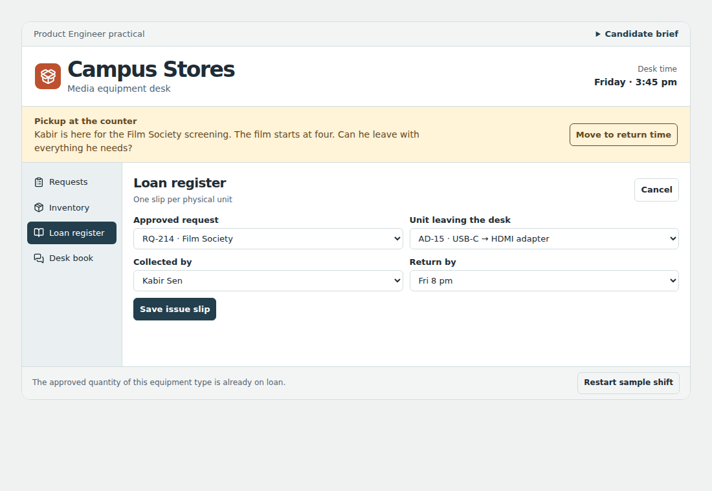
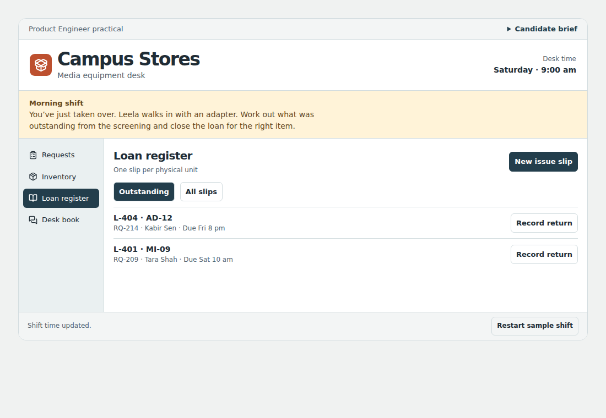
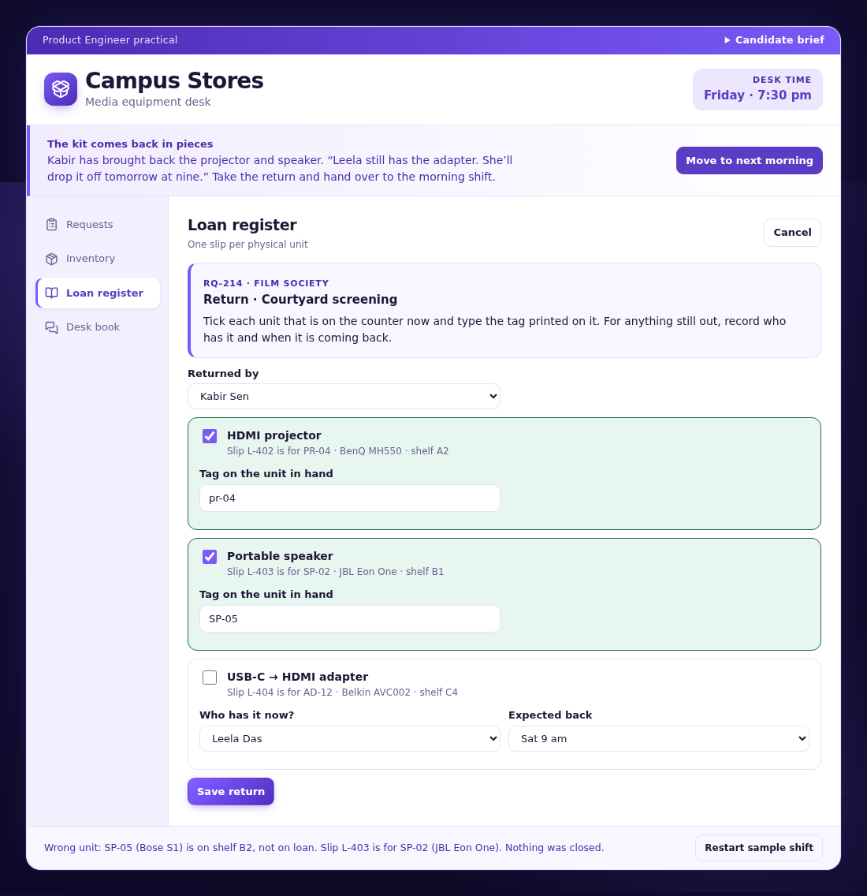
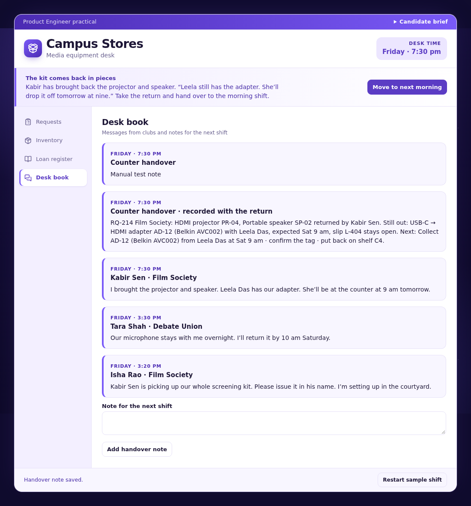
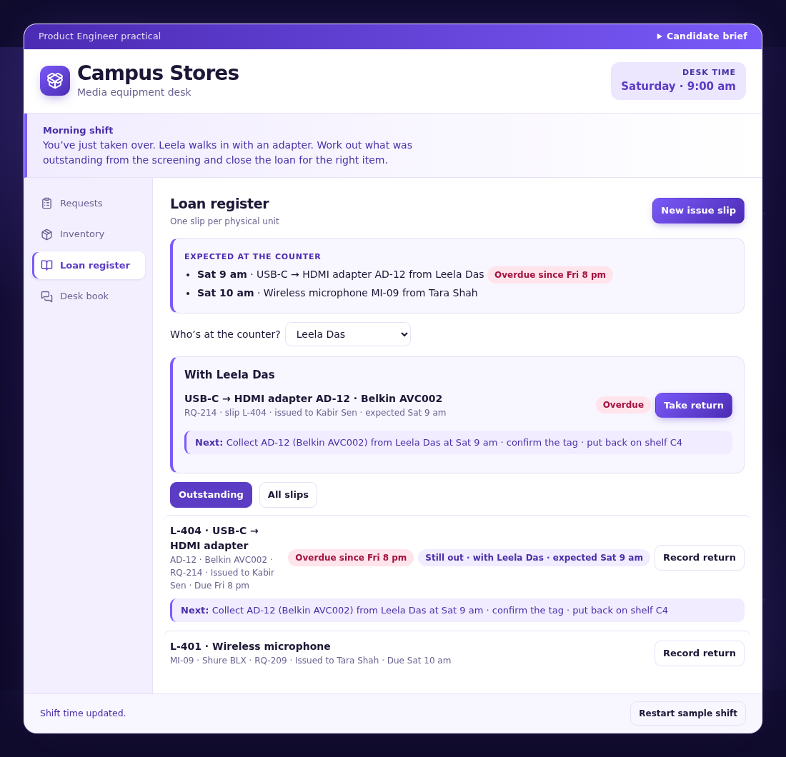
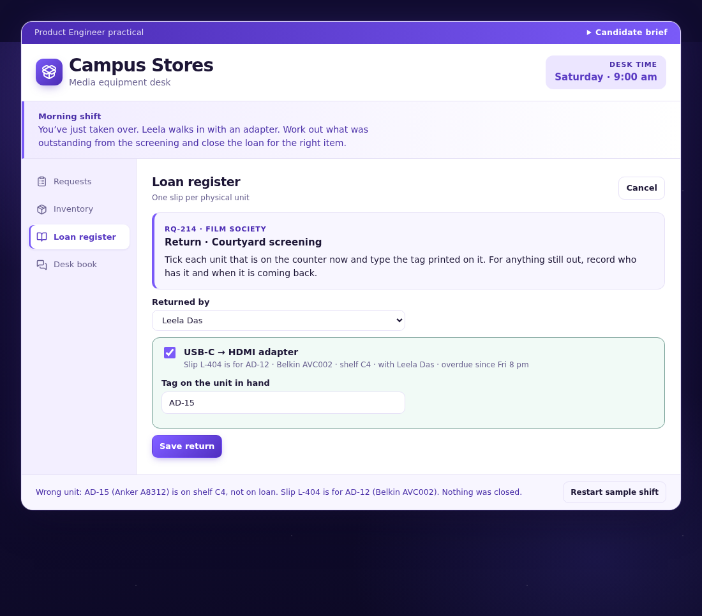

# Campus Stores

Campus Stores is a Product Engineer work sample set at a fictional campus media equipment desk. Work through a club’s screening, from equipment pickup to a partial return and the next morning’s handover. Open **Candidate brief** in the app for the assignment.

---

## My submission — reviewers start here

**Would I keep this product? Yes.** The desk gets the hard part of *issuing* right. I would change one thing: what happens when a kit comes back **incomplete**. Today the record of a missing unit lives only in a free-text note, so the next shift has to piece together the story before they can close the right loan.

**My change, in one line:** *when a kit comes back incomplete, the desk records where each missing unit is, who is bringing it back and when — and shows that to the next shift at the moment they need it.*

Everything I changed is in `app.js` and `styles.css` (search for `Prototype:` in `app.js`). The data model and the original issuing rules are untouched.

### How I worked the shift

| Desk time | What I did | What I noticed |
|---|---|---|
| Fri 3:45 pm | Issued PR-04 (projector), SP-02 (speaker) and AD-12 (adapter) to Kabir Sen on RQ-214, due Fri 8 pm. Tried to add a second adapter (AD-15). | The desk blocked the extra adapter. The projector in repair (PR-06) was never offered. |
| Fri 7:30 pm | Kabir returned the projector and speaker; Leela still had the adapter. I clicked **Record return** on L-402 and L-403. | Nothing asked about the missing adapter. L-404 stayed open **in Kabir’s name, due Fri 8 pm**. The only place to say “Leela has it, back at 9 am” was a free-text desk book note — which I had to remember to write. |
| Sat 9:00 am | As the new shift, Leela walked in with *an* adapter. | The register row read **“L-404 · AD-12 · RQ-214 · Kabir Sen · Due Fri 8 pm.”** No item type, no mention of Leela, no overdue flag. Two identical-looking adapters (AD-12, AD-15) share shelf C4. To close the right slip I had to cross-check the desk book, the register and the inventory. |

### One moment the product handles well — issuing against the approved request

At 3:45 pm I tried to issue a second USB-C adapter (AD-15) on RQ-214. The desk refused:

> *The approved quantity of this equipment type is already on loan.*

It also never offered PR-06, the projector in the workshop, and it rejects any unit whose type isn’t on the approved form. A rushed counter, a club member in a hurry, and two identical adapters on one shelf are exactly the conditions where over-issuing or handing out broken kit happens. The product makes the wrong action impossible instead of relying on the staffer to notice. **I kept all of this unchanged.**



### One moment I would change — the partial return and the morning handover

At 7:30 pm, the return flow only knows “returned” or “not returned”. The fact that matters most — *Leela has the adapter and will bring it at 9 am* — has nowhere structured to live. At 9 am this is all the next shift sees:



The record is about Kabir, the person at the counter is Leela, the item type isn’t shown, it isn’t marked overdue, and nothing says which of the two adapters on shelf C4 should come back. Closing the right loan depends on someone having written a good note and the next person finding it.

### The prototype — walking the same job with it

**Fri 3:45 pm — Pickup (unchanged).** Same issue slips, same checks. The register now names each unit (“L-404 · USB-C → HDMI adapter · AD-12 · Belkin AVC002”) and an **Expected at the counter** list shows everything due back, soonest first.

**Fri 7:30 pm — Partial return.** I pick **Who’s at the counter? → Kabir Sen** and click **Take return**. The whole RQ-214 kit opens as one checklist:

- I tick the projector and speaker and **type the tag on each unit in hand**. Typing SP-05 for the speaker is refused: *“Wrong unit: SP-05 (Bose S1) is on shelf B2, not on loan. Slip L-403 is for SP-02 (JBL Eon One). Nothing was closed.”*
- The adapter stays unticked, so the form asks **Who has it now?** (Leela Das) and **Expected back** (Sat 9 am). The return cannot be saved without them.



On save, only the two returned slips close. L-404 stays open with *Still out · with Leela Das · expected Sat 9 am* and a next step. A handover note is written automatically:

> *RQ-214 Film Society: HDMI projector PR-04, Portable speaker SP-02 returned by Kabir Sen. Still out: USB-C → HDMI adapter AD-12 (Belkin AVC002) with Leela Das, expected Sat 9 am, slip L-404 stays open. Next: Collect AD-12 (Belkin AVC002) from Leela Das at Sat 9 am · confirm the tag · put back on shelf C4.*



**Sat 9:00 am — Morning shift.** The register opens with the adapter at the top of **Expected at the counter**, marked **Overdue since Fri 8 pm**. Leela walks in; I pick **Who’s at the counter? → Leela Das**, and the desk finds the adapter even though the slip was issued to Kabir, with the next step spelled out:



I click **Take return** (“Returned by” is already Leela), tick the adapter and type the tag. If it were the wrong adapter, nothing closes:



Typing **AD-12** closes the slip: *“AD-12 returned by Leela Das. RQ-214 kit complete.”* The request page shows every unit of the kit as returned, and by whom.

### What I kept, and why

- **Issue-time checks** (approved types only, approved quantity, no units in repair) — they already prevent the costliest mistakes.
- **One slip per physical unit** — it is what makes a partial return representable at all; my change builds on it rather than replacing it.
- **The desk book** — still there for genuinely free-form messages; the system now writes the structured part of the handover for you.
- **The existing screens and navigation** — the change lives inside the return flow and the register, so staff don’t learn a new place to look.

### What I deliberately left out

- Faster pickup (issuing a whole kit at once) — a real improvement, but a different moment; I kept to one change.
- A separate “put-away” confirmation — the next step says “put back on shelf C4”, but the unit is marked on shelf as soon as the return is saved.
- Real scanning — the tag check is typed here; at a real desk it would be a barcode or QR scan.

### One observation at a real counter

> **When the person who has the missing item arrives the next morning, does the staffer close the right slip without opening the desk book or asking “which one is it?”, and do they check the tag before closing?**

If they still reach for the desk book or ask the student, the information isn’t where they need it and the change didn’t help. If they pick the person, check the tag and close it in one pass, it did.

### Also changed: visual design

I restyled the desk in a violet-on-white palette with a calm deep-space backdrop, light and dark themes, and the same mobile layout. This is cosmetic and separate from the product decision above; all colours are tokens at the top of `styles.css`.

### How I built and checked it

I used an AI coding assistant (Claude Code) to help prototype and to script a browser walkthrough. I drove the decisions about what to change and verified the full shift — pickup, partial return, wrong-tag and missing-holder cases, the morning handover, reload, restart, mobile width and dark mode — in Chromium.

---

## Run the app

Open `index.html` in a modern browser. The app includes its scripts, styles, and icons and can run offline.

To serve it over local HTTP, run this from the repository folder and visit `http://localhost:8000`.

```sh
python3 -m http.server 8000 --bind 127.0.0.1
```

Each browser stores its own sample shift locally when browser storage is available. **Restart sample shift** restores the fictional starting records.

## Source

- `index.html` contains the desk layout, candidate brief, and bundled icons.
- `app.js` contains the sample records and interactions.
- `styles.css` defines the desktop and mobile layouts.
- `docs/screenshots/` contains the before/after screenshots used above.

Icon license notices are in [third-party/lucide-LICENSE.txt](third-party/lucide-LICENSE.txt).
